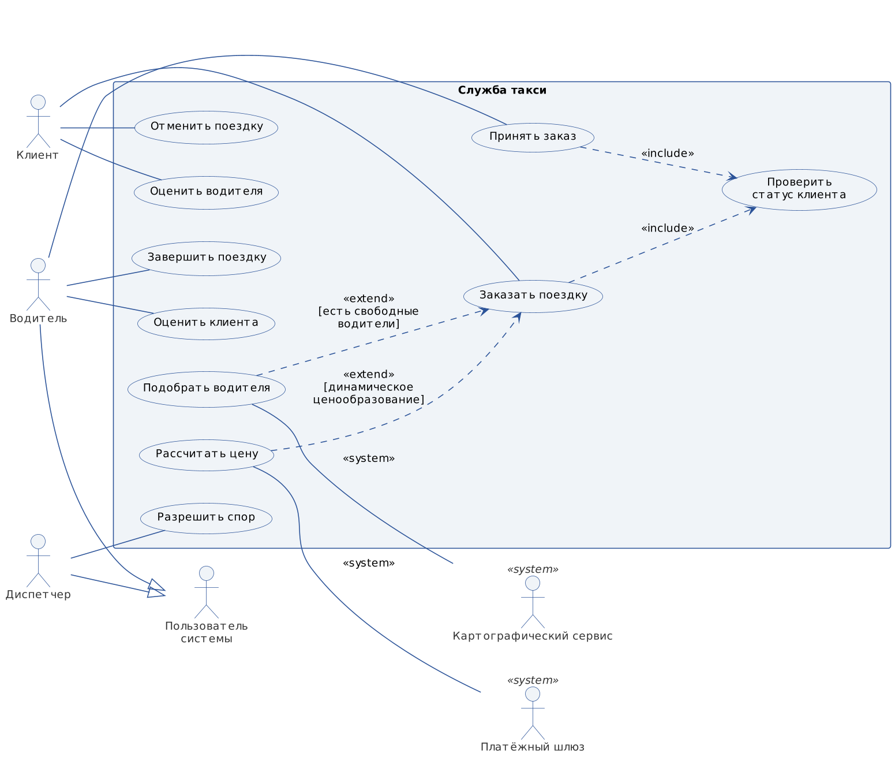
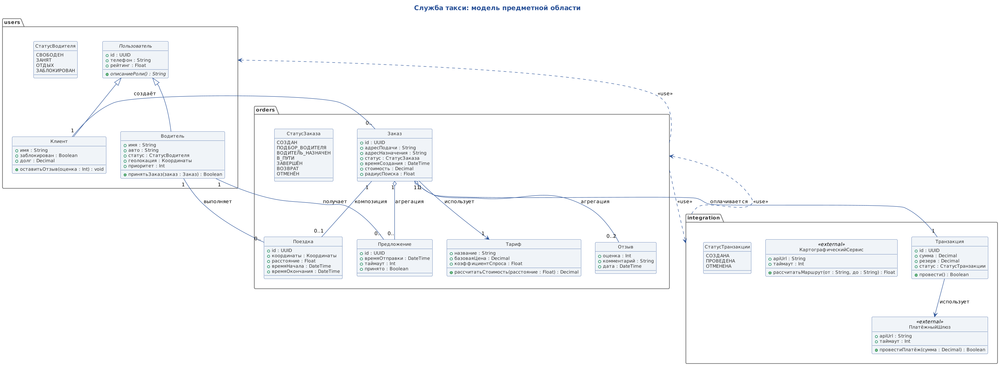
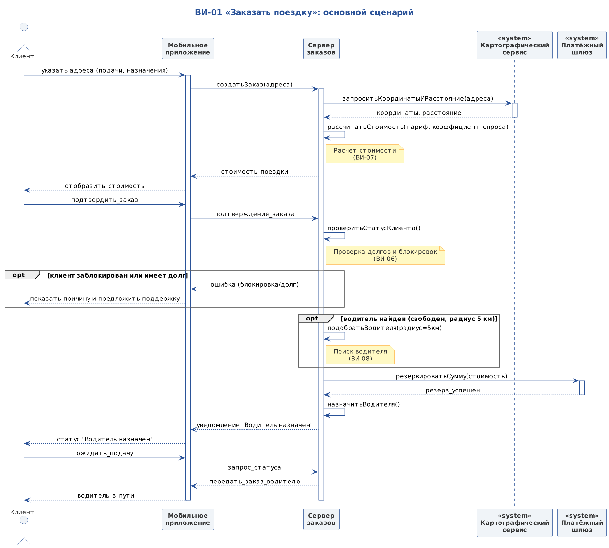
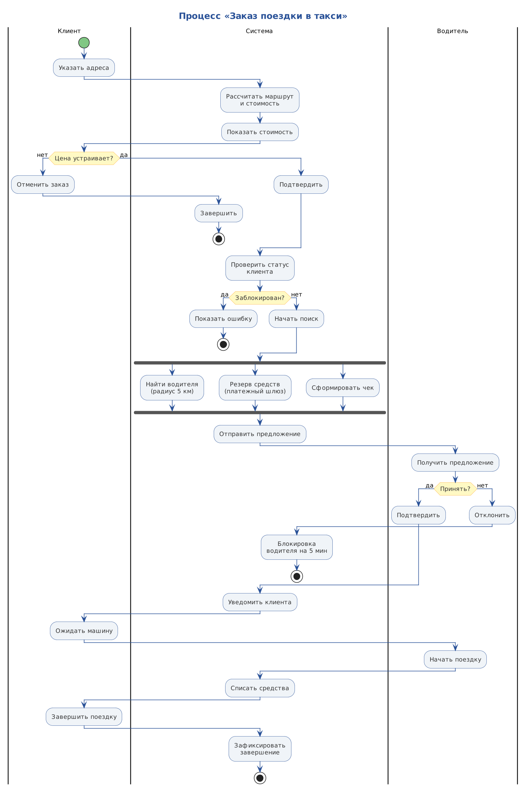
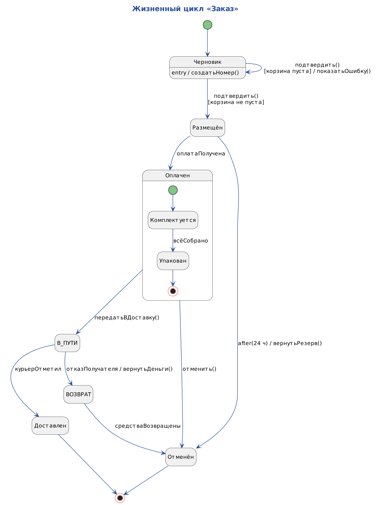
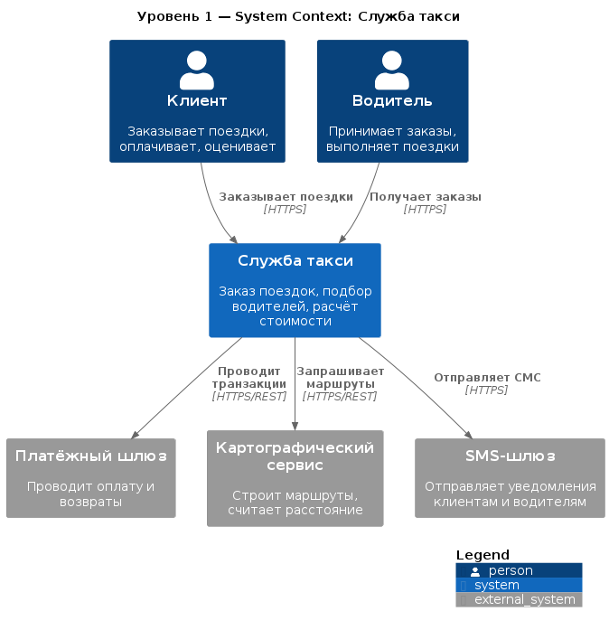
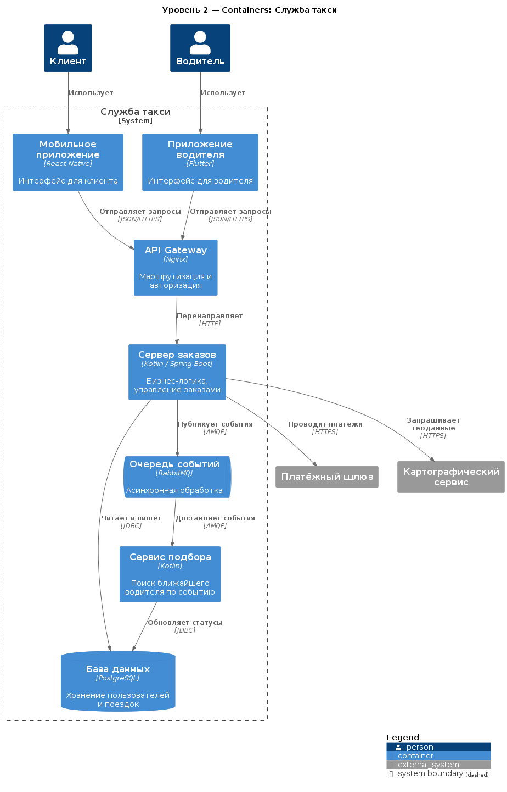
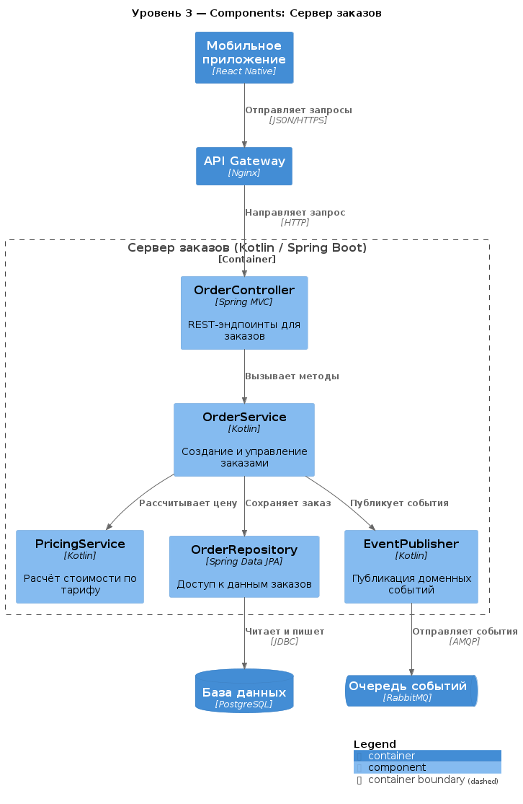
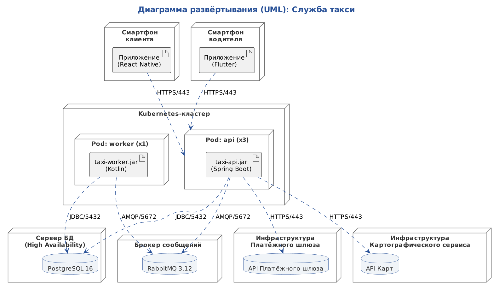

# Служба такси. Архитектурная документация

## 1. Назначение и границы

Система «Служба такси» представляет собой платформу для автоматизации заказа поездок, объединяющую клиентов и водителей. Основная задача системы — предоставить клиенту прозрачный и быстрый способ вызвать автомобиль, а водителю — эффективный инструмент для получения заказов и управления своим временем. 

В границы системы входят три ключевых компонента: клиентское мобильное приложение, серверная часть (бэкенд), отвечающая за бизнес-логику, и инфраструктурные элементы (базы данных и очереди сообщений). За пределами системы находятся внешние сервисы: платёжный шлюз (обеспечивающий финансовые транзакции) и картографический сервис (предоставляющий геоданные для построения маршрутов). Система не занимается непосредственно диспетчеризацией в ручном режиме (этим занимается только оператор в спорных ситуациях) и не управляет физическим автопарком.

## 2. Заинтересованные стороны и их цели

Цели стейкхолдеров напрямую влияют на функциональные требования. 

| Роль (Актер) | Цель в системе |
|---|---|
| **Клиент** | Быстро заказать такси, видеть актуальную стоимость и местоположение водителя, безопасно оплатить поездку. |
| **Водитель** | Получать релевантные предложения о заказах, минимизировать простои, получать стабильный доход. |
| **Диспетчер** | Контролировать аномальные ситуации (ДТП, жалобы), разрешать конфликты между клиентом и водителем. |
| **Платёжный шлюз** | Внешняя система: обеспечивает безопасное списание и возврат средств. |
| **Картографический сервис** | Внешняя система: рассчитывает оптимальный маршрут и время в пути. |

## 3. Функциональные требования

Функциональные возможности системы описаны на диаграмме вариантов использования (Use Case). Диаграмма показывает, какие действия доступны актерам.

Ключевые варианты использования:
*   **ВИ-01. Заказать поездку.** Включает в себя расчет стоимости, проверку статуса клиента и подбор водителя.
*   **ВИ-02. Отменить поездку.** Клиент может отменить заказ до или во время поездки (в последнем случае с удержанием штрафа).
*   **ВИ-03. Оценить водителя.** После завершения поездки клиент может выставить оценку, которая влияет на рейтинг водителя.

Детальные сценарии (основные и альтернативные потоки) описаны в файле [scenarios.md](01-usecase/scenarios.md). В частности, там раскрыт сценарий отмены заказа в пути с необходимостью возврата средств.

## 4. Модель предметной области

Модель классов описывает ключевые бизнес-сущности и связи между ними.

Ключевое архитектурное решение — разделение сущностей **«Заказ»** и **«Поездка»**. Заказ — это намерение клиента и финансовые условия (стоимость, тариф). Поездка — это физический процесс (время начала/окончания, координаты). Такое разделение позволяет корректно обрабатывать ситуации, когда заказ создан, но поездка еще не началась (например, водитель не найден). Также в модель введен статус **`ВОЗВРАТ`**, который позволяет системе отслеживать процесс возврата денежных средств при отмене поездки в пути (подробнее в [ADR-0001](adr/0001-otdelnyj-klass-zakaz.md) и [ADR-0003](adr/0003-vydelenie-statusa-vozvrat.md)).

## 5. Динамика системы

### 5.1 Основной сценарий (Sequence)
На диаграмме последовательности показан happy path — успешный заказ поездки. Клиент отправляет запрос, система рассчитывает стоимость, резервирует средства и подбирает водителя. Диаграмма демонстрирует синхронные вызовы между приложением и сервером.

### 5.2 Бизнес-процесс (Activity)
Диаграмма деятельности показывает процесс с точки зрения распределения работ по ролям. Использование дорожек (Клиент, Система, Водитель) позволяет увидеть, кто именно выполняет действие. Ключевая особенность — использование `fork/join` на этапе поиска водителя, когда система параллельно резервирует деньги и ищет свободного исполнителя. Это сокращает время отклика.

### 5.3 Жизненный цикл ключевого объекта (State)
Диаграмма состояний описывает жизненный цикл сущности «Заказ». Она показывает, как заказ переходит из состояния «Черновик» в «Завершен» или «Отменен». Особое внимание уделено альтернативным финалам: например, при отмене в пути заказ переходит в состояние `ВОЗВРАТ` (для возврата средств), а затем в `ОТМЕНЁН`.

## 6. Архитектура (модель C4)

### 6.1 Контекст (C4 L1)
Диаграмма контекста показывает систему «Служба такси» как черный ящик и ее взаимодействие с пользователями и внешними системами. На этом уровне абстракции мы не показываем внутренние технологии (базы данных, фреймворки), чтобы диаграмма была понятна заказчику.

### 6.2 Контейнеры (C4 L2)
Диаграмма контейнеров раскрывает внутреннее устройство системы. Показаны мобильные приложения (React Native и Flutter), API Gateway (Nginx), основной Сервер заказов (Spring Boot) и Сервис подбора. Важным решением является выделение **Очереди событий (RabbitMQ)** и отдельного **Сервиса подбора**. Это позволяет сделать поиск водителя асинхронным: сервер заказов не блокируется в ожидании ответа, а лишь публикует событие (подробнее в [ADR-0002](adr/0002-ochered-dlya-podbora.md)).

### 6.3 Компоненты (C4 L3)
Диаграмма компонентов детализирует устройство контейнера «Сервер заказов». Внутри выделены `OrderController` (прием запросов), `OrderService` (бизнес-логика), `PricingService` (расчет цены) и `OrderRepository` (работа с БД). Эти компоненты напрямую соотносятся с классами из доменной модели.

### 6.4 Развёртывание (Deployment)
Диаграмма развертывания показывает физическое размещение контейнеров: смартфоны пользователей, Kubernetes-кластер для бэкенда, серверы баз данных (PostgreSQL) и брокеров сообщений (RabbitMQ). На связях указаны используемые протоколы и порты (HTTPS, JDBC, AMQP).

## 7. Архитектурные решения

В ходе проектирования были приняты и задокументированы следующие ключевые решения:
1.  [ADR-0001. Заказ и Поездка — отдельные сущности](adr/0001-otdelnyj-klass-zakaz.md). Позволяет разделить финансовую логику и физический процесс поездки.
2.  [ADR-0002. Асинхронный поиск водителя через очередь](adr/0002-ochered-dlya-podbora.md). Повышает отказоустойчивость и скорость отклика при пиковых нагрузках.
3.  [ADR-0003. Введение статуса «ВОЗВРАТ»](adr/0003-vydelenie-statusa-vozvrat.md). Необходимо для корректного описания сценария отмены поездки в пути и возврата средств клиенту.

## 8. Что осталось за рамками

В рамках текущей итерации проектирования границы модели были сознательно ограничены. Следующие аспекты не были детализированы:

*   **Безопасность и аутентификация:** Не описаны механизмы аутентификации и авторизации пользователей (OAuth 2.0, JWT). На диаграммах C4 отсутствует контейнер Identity Provider.
*   **Детализация внешних интеграций:** Внешние системы (Платёжный шлюз, Карты) представлены как «черные ящики». Не раскрыты спецификации их API, стратегии обработки сетевых сбоев (retry policy, таймауты).
*   **Мониторинг и логирование:** В архитектуре не отражены компоненты observability (ELK-стек для логов, Prometheus/Grafana для метрик, Jaeger для трассировки), необходимые для поддержки production-среды.
*   **Уровень реализации (C4 L4 — Code):** Детализация классов и методов внутри компонентов не проводилась, так как уровня Component (C4 L3) достаточно для понимания архитектуры и постановки задач команде разработки.